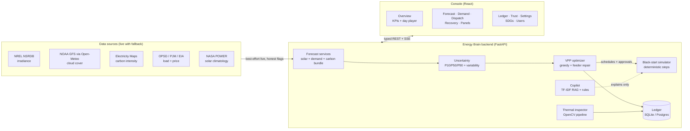

# Smart energy optimization and demand response

**One decision loop for the grid: Forecast → Uncertainty → Optimize → Act → Explain → Measure savings.**

A full-stack Virtual Power Plant (VPP) decision platform: it fuses solar and demand
forecasts with grid carbon intensity and tariffs, dispatches a fleet of flexible assets
(EVs, batteries, flexible loads) inside feeder limits, explains every decision in plain
language, and proves the outcome in an auditable savings ledger.

- **Live demo:** Overview console with a 24h simulate-and-scrub day player
- **Cross-border from day one:** Dhaka/Bangladesh (BDT), Berlin/EU (EUR), US-PJM (USD)
- **Offline-first:** realistic synthetic data everywhere; live connectors (NREL, Electricity
  Maps, OPSD, NOAA GFS via Open-Meteo, PJM, EIA, NASA POWER, Carbon Intensity UK, ENTSO-E)
  light up automatically when keys are set — every value carries a `live:*` / `synthetic`
  provenance flag
- **Secure by role:** JWT sessions + PBKDF2-hashed passwords, 4 roles, brute-force lockout,
  per-endpoint enforcement

---

## Table of contents

1. [Problem statement](#1-problem-statement)
2. [Solution](#2-solution)
3. [System architecture](#3-system-architecture)
4. [Features by module](#4-features-by-module)
5. [Roles and access control](#5-roles-and-access-control)
6. [Data sources](#6-data-sources)
7. [Tech stack](#7-tech-stack)
8. [Getting started](#8-getting-started)
9. [Configuration](#9-configuration)
10. [API overview](#10-api-overview)
11. [Testing and verification](#11-testing-and-verification)
12. [Deployment](#12-deployment)
13. [Project structure](#13-project-structure)
14. [SDG alignment](#14-sdg-alignment)
15. [Limitations and roadmap](#15-limitations-and-roadmap)
16. [Docs index](#16-docs-index)
17. [Contributing](#17-contributing)
18. [License and acknowledgments](#18-license-and-acknowledgments)

---

## 1. Problem statement

Grid operators, commercial energy managers, and fleet owners face the same painful
evening: demand spikes, prices spike, carbon intensity spikes — all at once.

1. **Expensive, dirty peaks.** In cities like Dhaka the evening peak (6–11 PM) is met
   by gas-dominated generation at ~670 g CO₂/kWh. Charging EVs or running flexible
   loads during the peak means paying the highest tariff for the dirtiest kilowatt-hour.
2. **Forecasts nobody can act on.** Solar and load forecasts usually arrive as single
   lines with no uncertainty, no provenance, and no link to a dispatch decision — so
   operators don't trust them when it matters.
3. **Flexible assets sit idle.** EV fleets, batteries, and shiftable loads could earn
   money and cut emissions by moving consumption a few hours — but there is no safe,
   explainable autopilot that guarantees hard constraints (departure state-of-charge,
   feeder limits) while doing it.
4. **No proof of savings.** Even when shifting works, the money and CO₂ saved are
   rarely metered with a stated methodology, so pilots never convert into contracts.
5. **Blackouts need rehearsal, not improvisation.** Recovery plans live in PDFs; there
   is no interactive way to rehearse islanding, cranking, and load pickup with
   stability checks before the real storm.

This project exists to close that loop: **every forecast becomes a feeder-safe
dispatch, every dispatch carries a plain-language reason and a counterfactual, and
every outcome lands in a ledger as a verifiable receipt.**

---

## 2. Solution

### The decision loop

```
FORECAST (solar P10/P50/P90 + demand P10/P50/P90 + carbon/price)
   → UNCERTAINTY (variability index, confidence bands — never a single line)
   → OPTIMIZE (cheapest-feasible-hour policy + feeder-limit repair + SoC guarantee)
   → ACT (schedules + human-in-the-loop approvals queue)
   → EXPLAIN (drivers, counterfactual "what if we did nothing", citations)
   → MEASURE (money saved, CO₂ avoided, peak shaved → ledger receipts)
```

### Headline metrics (always visible)

| Metric | Meaning | Methodology |
|---|---|---|
| Money saved | Tariff-weighted shifted kWh | kWh × time-of-use tariff per region |
| CO₂ avoided | Emissions not emitted | shifted kWh × marginal factor (avg selectable) |
| Peak shaved | Feeder stress removed | baseline peak − smart peak (kW) |
| Forecast skill | MAPE + pinball loss on holdout | 48 h backtest window |
| SoC guarantee | % of EVs meeting departure charge | optimizer-enforced, reported per EV (target: 100%) |

---

## 3. System architecture



### Request flow (example: smart dispatch)

1. `POST /api/v1/vpp/dispatch` (operator/admin only) with `{region_id, n_ev, lambda_co2, mu_peak}`.
2. Service builds a synthetic fleet (arrival/departure windows, SoC needs, max kW).
3. Baseline controller charges immediately at arrival; smart controller assigns each EV
   its cheapest feasible hours (effective price = tariff + λ·carbon), then repairs any
   feeder-limit violation by shifting load to the next-cheapest feasible slot.
4. Hard guarantees are verified per EV (delivered ≥ required); the run is logged to the
   ledger and an approval item is created for the operator queue.
5. Response ships schedules, before/after curves, savings, avoided CO₂, peak shaved,
   per-EV guarantees, fairness note, explanation, and counterfactual.

### Model choices (and why)

| Task | Model | Why this one |
|---|---|---|
| Solar quantiles | Clear-sky physics × advected cloud field + sklearn GBM quantile calibration | Fast on CPU, monotonic P10≤P50≤P90 by construction; LSTM path documented as the upgrade when torch + long histories exist |
| Cloud motion | FFT phase correlation (numpy only) | No OpenCV/torch needed; tested to <1.5 px error on synthetic shifts |
| Demand quantiles | sklearn GBM quantile + seasonal/temperature/weekday features | Same CPU/offline rationale; Transformer documented as upgrade |
| VPP dispatch | Cheapest-feasible-hour policy + feeder-repair optimizer | Auditable, always feasible, guarantees SoC; RL-style ordering without training instability |
| Thermal defects | OpenCV (normalize → Otsu → connected components → shape/ΔT rules) | Deterministic, explainable; CNN reserved for labeled-patch future |
| Copilot | TF-IDF retrieval over `backend/app/knowledge/*.md` + rule-based answers | Works fully offline; external LLM (if keyed) only re-words — it can never issue control actions |

---

## 4. Features by module

| Route | Module | What it does |
|---|---|---|
| `/` | **Overview** | KPI strip (saved, CO₂, peak, solar), 24h decision-timeline player with scrubber (24 h in 60 s), animated asset-flow diagram with live kW values, approvals queue with approve/reject |
| `/solar` | **Forecast studio** | lat/lon/capacity/horizon → P10/P50/P90, per-hour variability index, cloud-motion vector, animated advecting cloud frames, live Open-Meteo blend with per-field provenance |
| `/demand` | **Demand forecast** | Quantile load forecast, feature importance, MAPE/pinball backtest, attention summary |
| `/vpp` | **Dispatch agent** | Baseline vs smart controllers side by side, λ/μ sliders, feeder-limit repair, per-EV "charged by" guarantees, fairness note, scenario compare (A/B with deltas) |
| `/grid` | **Recovery copilot** | 4 failure scenarios, 6-step deterministic black-start with animated SVG re-energization, autoplay replay, copilot chat citing procedure docs + sim steps, human-in-the-loop approvals |
| `/panels` | **Panel inspector** | 3 bundled thermal samples **or your own upload**, OpenCV defects (hotspot/diode/soiling/string), annotated overlay, efficiency loss %, yearly kWh + money loss |
| `/ledger` | **Carbon & cost ledger** | Cumulative savings/CO₂/peak, filterable entries, CSV export, print-friendly report, seed/reset (admin), methodology tooltip |
| `/trust` | **Trust & responsible AI** | Assurance tiles (live counts), provenance, fairness evidence, failure-mode accordion, filterable override timeline with approval donut |
| `/settings` | **Settings & integrations** | Region cards, carbon methodology, theme, live-vs-synthetic provider list with refresh, model status, API docs link |
| `/sdgs` | **SDG goals** | Official UN icons for SDG 7/9/11/12/13, live ledger-driven numbers, and a Bangla photo story from Bangladesh |
| `/users` | **Users & roles** | Admin-only user CRUD, role changes, enable/disable, password resets |
| `/login` | **Sign in** | Role cards with generated icons, animated loading shell while the session opens |

Cross-cutting: command palette (Ctrl/⌘+K with search + keyboard nav), light/dark theme, responsive layout, print styles, route-level error boundary, loading skeletons + spinners + error-with-retry states on every async surface.

---

## 5. Roles and access control

Single source of truth: `frontend/src/lib/permissions.ts` mirrors the backend's
`require_roles` map, so the UI only shows what the API will actually allow.

| Role | Sees | Can additionally do |
|---|---|---|
| **Viewer** | Overview (read-only) · Ledger · Trust · Settings · SDGs | Export CSV |
| **Manager** | + Forecast · Demand · Recovery · Panels | Forecasts, inspections, copilot, simulate-a-day, scenario compare, live-data refresh |
| **Operator** | + Dispatch | Dispatch fleets, request/approve grid actions |
| **Admin** | + Users | Manage users & roles, seed/reset ledger |

Security: PBKDF2-HMAC-SHA256 passwords (unique salt per user), expiring HS256 JWTs
signed with `SECRET_KEY`, 5-strikes-in-5-minutes login lockout, roles re-checked from
the database on every request (demotions take effect immediately), viewers read-only
by construction, built-in `admin` cannot be demoted/deleted/disabled.

Demo accounts (change or remove before any real use): `admin/admin123`,
`operator/op123`, `manager/mgr123`, `viewer/view123`.

---

## 6. Data sources

All providers live in `backend/app/data/providers.py`. Every response carries
`source: "live:*" | "synthetic"` — the UI shows provenance honestly per field.

| Source | Key | Used for | Without key |
|---|---|---|---|
| NREL NSRDB (PSM v3) | `NREL_API_KEY` (free) | Site irradiance check (cached 24 h) | Clear-sky physics |
| NOAA GFS via Open-Meteo | none (free) | Live cloud cover + temperature blended into solar | Advected synthetic cloud field |
| NASA POWER | none (free) | Solar irradiance fallback | Clear-sky physics |
| Electricity Maps | `ELECTRICITY_MAPS_KEY` (trial/paid) | Real-time grid CO₂ per zone | Static regional factors |
| Carbon Intensity UK | none (free) | EU proxy carbon for Berlin | Static factors |
| OPSD time series | none (one-time ~100 MB download) | German load slice (`POST /integrations/opsd-refresh`) | Synthetic load shapes |
| PJM Data Miner | `PJM_API_KEY` (free) | 7-day US load forecast | Synthetic PJM shape |
| US EIA v2 | `EIA_API_KEY` (free) | Hourly wind generation context | Synthetic |
| ENTSO-E Transparency | `ENTSOE_API_KEY` (free) | EU prices/load slot (status-tracked) | Synthetic EU shapes |
| OpenAI / Anthropic | optional, paid | Copilot wording only — never controls the grid | Rule-based explainer |

Full guide with endpoints, quotas, and fallback rules: [`docs/DATA_SOURCES.txt`](docs/DATA_SOURCES.txt).
Refresh keyless providers live from Settings → **Refresh live data**
(`POST /api/v1/integrations/refresh`).

---

## 7. Tech stack

- **Backend:** Python 3.11+, FastAPI, Pydantic v2, SQLAlchemy 2 (SQLite local / Postgres
  in production), NumPy, SciPy, scikit-learn, OpenCV-headless, Pillow, PyJWT, httpx, Uvicorn.
- **Frontend:** React 18 + TypeScript + Vite, Tailwind CSS, React Router v6, TanStack Query,
  Recharts, Zustand, Framer Motion, lucide-react.
- **Design language:** "control room at dusk" — warm neutrals, one amber signal color,
  hairline borders, serif display + grotesk UI + mono numerals (no gradients-as-decoration).
- **Infra:** Dockerfiles, `docker-compose.yml`, `Makefile`, `render.yaml` Blueprint.

---

## 8. Getting started

Prerequisites: Python 3.11+, Node 20+.

```bash
# backend (terminal 1) — http://127.0.0.1:8000/docs
cd backend
pip install -r requirements.txt
uvicorn app.main:app --reload

# frontend (terminal 2) — http://localhost:5173
cd frontend
npm install
npm run dev
```

One-command alternatives: `make backend` / `make frontend` / `make test` / `make build`,
or `docker-compose up --build`.

Copy `.env.example` → `.env` to add API keys (everything works without them).

---

## 9. Configuration

| Variable | Default | Purpose |
|---|---|---|
| `SECRET_KEY` | dev-only placeholder | JWT signing — **must be replaced in production** |
| `TOKEN_HOURS` | `12` | Session lifetime |
| `DATABASE_URL` | `sqlite:///./energy_brain.db` | SQLAlchemy URL (Postgres on Render) |
| `MODEL_CACHE_DIR` | `./.model_cache` | Live-data cache |
| `LIVE_TIMEOUT_S` | `6` | Provider HTTP timeout |
| `ENERGY_BRAIN_OFFLINE` | unset | Set to `1` to force fully synthetic mode (used by tests) |
| `NREL_API_KEY`, `ELECTRICITY_MAPS_KEY`, `PJM_API_KEY`, `EIA_API_KEY`, `ENTSOE_API_KEY`, `OPENAI_API_KEY`, `ANTHROPIC_API_KEY` | empty | Live data / LLM keys (see §6) |
| `CORS_ORIGINS` | vite defaults | Allowed browser origins |

---

## 10. API overview

Base path `/api/v1`. Interactive docs at `/docs`. Auth: `Authorization: Bearer <JWT>`
(except `/auth/login`, `/health`, `/`).

| Area | Endpoints |
|---|---|
| Auth & users | `POST /auth/login`, `GET /auth/me`, `GET/POST /users`, `PATCH/DELETE /users/{id}` (admin) |
| Solar | `POST /solar/forecast`, `GET /solar/status` |
| Demand | `POST /demand/forecast` |
| VPP | `POST /vpp/dispatch`, `GET /vpp/stream` (SSE, `?token=`) |
| Grid | `GET /grid/scenarios`, `POST /grid/simulate`, `POST /grid/copilot`, `GET /grid/stream` (SSE) |
| Panels | `GET /panels/samples`, `POST /panels/inspect` (sample or multipart upload) |
| Ledger | `GET /ledger/summary`, `GET /ledger/entries`, `GET /ledger/export.csv`, `POST /ledger/log\|seed\|reset` |
| Approvals | `GET /approvals`, `POST /approvals`, `POST /approvals/{id}/decide` |
| Regions & live | `GET /regions`, `GET /regions/{id}`, `GET /regions/{id}/live` |
| Integrations | `GET /integrations/status`, `POST /integrations/refresh`, `POST /integrations/opsd-refresh` |
| Simulation | `POST /simulate/day`, `POST /scenarios/compare`, `GET /models/status`, `GET /health` |

---

## 11. Testing and verification

```bash
cd backend && python -m pytest tests -q   # 30 tests, all passing
cd frontend && npm run build              # TypeScript + production build, clean
```

Coverage highlights: quantile-band monotonicity, cloud-motion error tolerance, VPP SoC
guarantee + savings/peak dominance, black-start stability + copilot citations, thermal
defect detection, ledger/approval flows, offline provider fallbacks, and a full RBAC
matrix (anonymous 401, viewer 403 on compute, admin-only user management, lockout,
built-in admin protection).

---

## 12. Deployment

### Render (recommended)

`render.yaml` provisions a single web service (API + built SPA, same origin) plus
managed Postgres:

1. Push this repo to GitHub.
2. Render Dashboard → **New → Blueprint** → select the repo → **Apply**.
3. First deploy takes a few minutes (pip + npm build). Open the service URL.

Production notes: Postgres via `DATABASE_URL`; `SECRET_KEY` auto-generated; set live-data
keys as environment variables; replace/remove demo accounts.

### Docker

`docker-compose up --build` (separate backend/frontend services for local parity).

---

## 13. Project structure

```
backend/app/
  main.py            # app factory, CORS, request IDs, routers, SPA serving
  core/              # settings, SQLite/Postgres engine, regions, RBAC security
  api/               # thin routers: auth, solar, demand, vpp, grid, panels, misc
  services/          # ledger models, copilot (TF-IDF RAG + rules)
  ml/                # solar, demand, vpp optimizer, cloud motion, thermal, gridsim
  data/              # synthetic generators, live providers, connectors
  schemas/           # Pydantic v2 request/response models
  knowledge/         # black-start procedures (*.md, cited by the copilot)
  tests/             # 30 pytest tests
frontend/src/
  app/router.tsx     # routes + role guards + error boundary
  components/        # Layout, RequireAuth, RouteError, design-system ui
  pages/             # Overview, Solar, Demand, Vpp, Grid, Panels, Ledger, Trust, Settings, Sdgs, Users, Login
  lib/               # api client (token attach, 401 redirect), permissions matrix, formatting
  state/             # region/theme prefs + auth store
docs/                # ARCHITECTURE, BUSINESS, IMPACT, DEMO_SCRIPT, SCALING, DATA_SOURCES
```

---

## 14. SDG alignment

See the in-app **SDGs page** (`/sdgs`, visible to every role): official UN icons and
live ledger-driven numbers for **SDG 7** (Affordable & Clean Energy) and **SDG 13**
(Climate Action) as primary goals, plus **SDG 9** (Industry & Infrastructure),
**SDG 11** (Sustainable Cities) and **SDG 12** (Responsible Consumption) as secondary —
including a Bangla photo story from Bangladesh with Wikimedia Commons imagery.

---

## 15. Limitations and roadmap

Honest status: **demo/pilot-grade, not market-ready.** The launch blockers are
authentication hardening beyond demo accounts, Postgres-backed production ops,
measurement & verification of savings against real meters (today's numbers come from
synthetic fleets), per-currency ledger totals, and data-license review (OPSD is CC-BY).
Planned next: torch-based LSTM/Transformer model paths, OpenADR/IEEE 2030.5 signal
support, e2e + load testing, and pilot contracts with 1–2 fleets. Details in
[`docs/IMPACT.md`](docs/IMPACT.md) and [`docs/SCALING.md`](docs/SCALING.md).

---

## 16. Docs index

- [`docs/ARCHITECTURE.md`](docs/ARCHITECTURE.md) — pipeline diagram, model choices, fallbacks, explainability design
- [`docs/BUSINESS.md`](docs/BUSINESS.md) — value proposition, SaaS tiers, adoption path, cross-border plan
- [`docs/IMPACT.md`](docs/IMPACT.md) — KPIs, responsible AI, bias mitigation, privacy
- [`docs/DEMO_SCRIPT.md`](docs/DEMO_SCRIPT.md) — 3-minute demo click path with talking points
- [`docs/SCALING.md`](docs/SCALING.md) — containers, Postgres/Timescale, standards, contributors
- [`docs/DATA_SOURCES.txt`](docs/DATA_SOURCES.txt) — every data resource, keys, usage, fallbacks

---

## 17. Contributing

1. Run the checks: `cd backend && python -m pytest tests -q`, `cd frontend && npm run build`.
2. Keep every new endpoint role-guarded (`require_roles`) and every UI action behind the
   `permissions.ts` matrix — the two must stay in sync.
3. Every number shown to users needs a provenance flag and, where relevant, an
   uncertainty band and a counterfactual.
4. Add tests for new behavior (offline-safe: honor `ENERGY_BRAIN_OFFLINE=1`).

---

## 18. License and acknowledgments

License: MIT (see `LICENSE` — to be added before public launch; all code in this repo is
original unless noted below).

- SDG icons © United Nations (sdgs.un.org), used for informational purposes.
- Story photography: Wikimedia Commons contributors (CC BY-SA).
- Live-data providers: NREL, NOAA/DWD via Open-Meteo, NASA POWER, Electricity Maps,
  National Grid ESO, OPSD, PJM, U.S. EIA, ENTSO-E — see [`docs/DATA_SOURCES.txt`](docs/DATA_SOURCES.txt).
