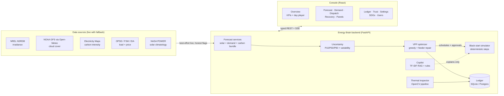

# Smart Energy Optimization and Demand Response — Full Project Documentation

**Version:** 1.0 · **Date:** November 2026
**Repository:** https://github.com/tusher466/smart-energy-optimization-and-demand-response
**Landing pages repo:** https://github.com/tusher466/smart-energy-optimization-and-demand-response-landing-pages
**Tagline:** *Forecast → Uncertainty → Optimize → Act → Explain → Measure savings.*

---

## Table of Contents

1. [1. Project Name & Identity](#1-project-name--identity)
2. [2. Problem Statement](#2-problem-statement)
3. [3. Our Solution](#3-our-solution)
4. [4. System Architecture](#4-system-architecture)
5. [5. End-to-End Workflows](#5-end-to-end-workflows)
6. [6. AI Models We Use](#6-ai-models-we-use)
7. [7. RAG (Retrieval-Augmented Generation) in Detail](#7-rag-retrieval-augmented-generation-in-detail)
8. [8. Full Project Details (Module by Module)](#8-full-project-details-module-by-module)
9. [9. Tech Stack & Frameworks](#9-tech-stack--frameworks)
10. [10. Data Resources](#10-data-resources)
11. [11. Backend Details](#11-backend-details)
12. [12. Frontend Details](#12-frontend-details)
13. [13. Roles, Security & Access Control](#13-roles-security--access-control)
14. [14. Deployment](#14-deployment)
15. [15. Verification & Test Evidence](#15-verification--test-evidence)
16. [16. Future Work](#16-future-work)

---

## 1. Project Name & Identity

- **Project name:** Smart energy optimization and demand response
- **Short identity / brand mark:** "E" (amber tile used in the header, login and favicon areas)
- **One-line description:** A smart energy optimization and demand-response platform that fuses
  solar and demand forecasts with grid carbon intensity and tariffs, dispatches a fleet of
  flexible assets (EVs, batteries, flexible loads) as a Virtual Power Plant (VPP) inside
  feeder limits, explains every decision in plain language, and proves the outcome in an
  auditable savings ledger.
- **Target users:** (1) commercial/industrial energy managers, (2) VPP / aggregator operators,
  (3) grid operators. Cross-border from day one: Bangladesh/South Asia, EU, US-PJM.

---

## 2. Problem Statement

1. **Expensive, dirty evening peaks.** In Dhaka the 6–11 PM peak is met by gas-dominated
   generation at ~670 g CO₂/kWh. Charging EVs or running flexible loads at peak means paying
   the highest tariff for the most carbon-intensive kilowatt-hour — and risking feeder trips.
2. **Forecasts nobody can act on.** Solar and load forecasts typically arrive as single lines
   with no uncertainty bands, no provenance, and no link to a dispatch decision — so operators
   ignore them exactly when clouds matter most.
3. **Idle flexible assets.** EVs, batteries and shiftable loads sit unused during cheap,
   clean night hours because there is no safe, explainable autopilot that guarantees hard
   constraints (departure state-of-charge, feeder limits) while shifting load.
4. **Savings nobody can prove.** Even when shifting works, the money and CO₂ saved are rarely
   metered with a stated methodology, so pilots never convert into contracts.
5. **Blackouts with no rehearsal.** Recovery plans live in PDFs. There is no interactive way
   to rehearse islanding, cranking power and load pickup with stability checks before the
   real storm — while flood- and cyclone-exposed regions like Bangladesh can least afford it.

---

## 3. Our Solution

### 3.1 The decision loop (the product in one diagram)

```
FORECAST (solar P10/P50/P90 + demand P10/P50/P90 + carbon/price)
  -> UNCERTAINTY (variability index, confidence bands — never a single line)
  -> OPTIMIZE (cheapest-feasible-hour policy + feeder-limit repair + SoC guarantee)
  -> ACT (schedules + human-in-the-loop approvals queue)
  -> EXPLAIN (top drivers, counterfactual, confidence, citations)
  -> MEASURE (money saved, CO2 avoided, peak shaved -> ledger receipts)
```

### 3.2 Headline metrics (always visible on the Overview console)

| Metric | Meaning | Methodology |
|---|---|---|
| Money saved | Tariff-weighted shifted kWh | kWh x time-of-use tariff per region |
| CO₂ avoided | Emissions not emitted | shifted kWh x marginal factor (average selectable) |
| Peak shaved | Feeder stress removed | baseline peak minus smart peak (kW) |
| Forecast skill | MAPE + pinball loss on holdout | 48-hour backtest window |
| SoC guarantee | % of EVs meeting departure charge | Optimizer-enforced, reported per EV (target: 100%) |

### 3.3 Design principles

- **Offline-first:** realistic synthetic data everywhere; live connectors light up automatically
  when API keys exist. Every number carries a `live:*` / `synthetic` provenance flag.
- **No black boxes:** every output ships with drivers, a counterfactual ("what if we had done
  nothing"), a confidence band, data sources, and a pinned model version.
- **Humans approve, machines propose:** the copilot and the dispatch agent can never act alone;
  every automated action lands in an approvals queue.
- **Cross-border by config:** regions are data (`backend/app/core/regions.py`), not code —
  tariffs, currency, carbon factors and peak hours switch instantly.

---

## 4. System Architecture

### 4.1 High-level diagram



### 4.2 Request path map

- Frontend (`frontend/src/`) talks to the backend over typed REST under `/api/v1`
  (dev: Vite proxy `/api` -> backend; production: same origin, FastAPI serves the built SPA).
- Server-Sent Events stream live simulation ticks for VPP dispatch and black-start steps
  (`GET /api/v1/vpp/stream`, `GET /api/v1/grid/stream`, token via `?token=` query).
- OpenAPI docs at `/docs`; health at `/api/v1/health` (also the Render health check).
- SQLite locally (`backend/energy_brain.db`); any SQLAlchemy URL in production
  (`DATABASE_URL`, e.g. Render Postgres — `postgres://` is auto-normalized to `postgresql://`).

### 4.3 Key backend files

| Path | Responsibility |
|---|---|
| `backend/app/main.py` | App factory, CORS, request IDs, routers, startup warm-up, SPA serving in production |
| `backend/app/core/config.py` | Settings via `pydantic-settings` (`.env` supported) |
| `backend/app/core/db.py` | SQLAlchemy engine/session/Base, `init_db()` |
| `backend/app/core/regions.py` | Region profiles: tariffs, currency, carbon factors, feeder limits |
| `backend/app/core/security.py` | PBKDF2 hashing, JWT, lockout, `require_roles()` dependency factory, default users |
| `backend/app/api/*.py` | Thin routers: `auth`, `solar`, `demand`, `vpp`, `grid`, `panels`, `misc` |
| `backend/app/schemas/models.py` | Pydantic v2 request/response models |
| `backend/app/services/` | `ledger_models.py` (DecisionLog, Approval), `copilot.py` (RAG + rules) |
| `backend/app/ml/` | `solar.py`, `demand.py`, `vpp.py`, `cloud_motion.py`, `thermal.py`, `gridsim.py` |
| `backend/app/data/` | `synthetic.py`, `providers.py` (live fetchers + cache), `connectors.py` (compat layer) |
| `backend/app/knowledge/` | Black-start procedures (`islanding.md`, `cranking.md`, `load-pickup.md`) |

---

## 5. End-to-End Workflows

### 5.1 Smart dispatch (the core loop)

1. `POST /api/v1/vpp/dispatch` `{region_id, n_ev, lambda_co2, mu_peak}` (operator/admin only).
2. Fleet simulator builds N EVs (arrival/departure, SoC arrival/required, max kW) + batteries.
3. **Baseline** charges every EV immediately at arrival (the expensive habit).
4. **Smart policy** assigns each EV its cheapest feasible hours
   (effective price = tariff + λ·carbon), then repairs feeder-limit violations by moving
   load to the next-cheapest feasible hour — never past a departure deadline.
5. Every EV is verified (`delivered ≥ required`); the run, its savings and an approval item
   are written to the ledger/queue. Response includes schedules, before/after curves, per-EV
   guarantees, fairness note, explanation and counterfactual.

### 5.2 Black-start rehearsal

1. Pick a scenario (`cloud-collapse`, `wind-lull`, `line-trip`, `cyber-outage`).
2. Deterministic 6-step simulation: islands → cranking power → corridor → priority load
   (hospitals first) → island sync → full restoration, each with frequency/voltage checks
   (48.8–51.0 Hz, 0.94–1.06 pu; violations marked UNSTABLE and held).
3. SVG network re-energizes step by step; the copilot answers questions citing the exact
   procedure doc and simulation step; operator approval is required (human-in-the-loop).

### 5.3 Thermal inspection

Upload (or pick a bundled sample) → grayscale→temperature mapping → Otsu threshold →
connected components → classify by area/aspect-ratio/ΔT (hotspot cell, bypass-diode
failure, soiling band, string fault) → annotated overlay PNG + defect table + estimated
efficiency loss %, yearly kWh and money loss in the region's currency.

### 5.4 Simulate-a-day & scenario compare

- `POST /api/v1/simulate/day` plays 24 h (solar P50, demand P50, EV smart vs baseline) and
  logs one ledger receipt; the frontend animates it in ~60 s with a scrubber.
- `POST /api/v1/scenarios/compare` runs two VPP configs and returns delta KPIs.

---

## 6. AI Models We Use

| Task | Model / method | File | Why this choice |
|---|---|---|---|
| Solar quantiles | Clear-sky physics x advected cloud field + sklearn GradientBoosting quantile regression (P10/P50/P90) | `ml/solar.py` | Fast on CPU, monotonic bands by construction, works fully offline; LSTM path documented as the upgrade when torch + long histories exist |
| Cloud motion | FFT phase-correlation (numpy only) | `ml/cloud_motion.py` | No OpenCV/torch needed; tested to <1.5 px error on synthetic shifts |
| Demand quantiles | sklearn GBM quantile (seasonal + temperature + weekday features) + holdout backtest (MAPE, pinball) | `ml/demand.py` | Same offline rationale; compact Transformer documented as upgrade |
| VPP dispatch | Cheapest-feasible-hour policy (RL-style ordering) + feeder-repair optimizer + hard SoC feasibility proof | `ml/vpp.py` | Auditable, always feasible, guarantees departures; no training instability |
| Thermal defects | OpenCV pipeline (normalize → Otsu → connected components → shape/ΔT rules) | `ml/thermal.py` | Deterministic and explainable; CNN reserved for labeled-patch future |
| Black-start | Deterministic recovery-sequence simulator | `ml/gridsim.py` | Rule-based physics checks, reproducible rehearsals |
| Copilot language | TF-IDF retrieval + rule-based explainer; external LLM (OpenAI/Anthropic) only re-words when keyed | `services/copilot.py` | Works offline; the LLM can never issue control actions |

**Model selection logic (summary):** physics + classical ML where data is scarce and
auditability matters (solar, demand, thermal); greedy optimization with hard-constraint
guarantees where safety matters (dispatch, black-start); LLM strictly confined to
explanation with citations.

---

## 7. RAG (Retrieval-Augmented Generation) in Detail

Where it lives: `backend/app/services/copilot.py` + `backend/app/knowledge/*.md`.

1. **Knowledge base (3 docs):** `islanding.md` (form islands first, verify frequency),
   `cranking.md` (black-start units, corridor energization, voltage/phase checks),
   `load-pickup.md` (2–3 MW blocks, hospital priority, stability-gated steps, sync rules).
2. **Retrieval:** each question is tokenized (`[a-z0-9]+`), TF vectors are built per doc,
   and cosine similarity ranks the docs; top-2 are returned with scores and 600-char excerpts.
3. **Grounding:** the answer cites `cited_docs` (e.g. `["load-pickup", "cranking"]`) and a
   `simulation_step_ref` chosen by keyword (island→1, crank→2, hospital/pickup→4, sync→5).
4. **Generation (rule-based):** intent templates cover why-explanations, safety/risk, next-step,
   and a default grounding answer. If `OPENAI_API_KEY`/`ANTHROPIC_API_KEY` is set, an external
   LLM may only *re-word* the answer (`llm: external-llm-explanation-only`); otherwise
   `llm: rule-based-local`. Either way the response carries
   `badge: "human-in-the-loop: proposal only, operator must approve"`.
5. **Safety boundary:** the copilot has no control path — it cannot issue dispatches, close
   breakers, or mutate state. Operator approval is a separate, role-gated API call
   (`POST /api/v1/approvals/{id}/decide`, operator/admin only).

---

## 8. Full Project Details (Module by Module)

- **Overview (`/`)** — KPI strip with count-up animation (saved, CO₂, peak, solar), 24h
  decision-timeline player with scrubber + progress bar, animated asset-flow SVG with live kW
  values and traveling energy packets, human approvals queue with approve/reject.
- **Forecast (`/solar`)** — lat/lon/capacity/horizon inputs, P10/P50/P90 chart, hourly
  variability (ramp-risk) bars, animated cloud-field advection over the site, motion vector,
  per-field provenance (`data_sources: cloud/temperature/irradiance`).
- **Demand (`/demand`)** — quantile load chart, horizontal feature-importance bars, MAPE +
  pinball backtest panel, attention/feature summary.
- **Dispatch (`/vpp`)** — EV count + λ (CO₂) + μ (peak) controls, before/after feeder chart,
  scenario compare (A/B + deltas), per-EV "charged by" guarantee table, fairness note,
  explain drawer with counterfactual.
- **Recovery (`/grid`)** — scenario picker, autoplay SVG re-energization, step list with
  Hz/pu stability flags, per-step "request approval", copilot chat with citations.
- **Panels (`/panels`)** — 3 bundled thermal samples **or your own upload**, annotated overlay,
  severity-badged defect table, efficiency-loss % and yearly kWh + money loss.
- **Ledger (`/ledger`)** — cumulative KPIs, entries table with sticky header, CSV export
  (auth-aware download), print-friendly report, seed/reset (admin), methodology tooltip.
- **Trust (`/trust`)** — live assurance tiles, provenance, fairness evidence with delivery
  bars, failure-mode accordion, approval-outcomes donut + filterable override timeline.
- **Settings (`/settings`)** — region cards, carbon methodology radio, theme switch, data/demo
  actions, live-vs-synthetic provider list with refresh, model-status grid, API-docs link.
- **SDGs (`/sdgs`)** — visible to every role: official SDG 7/9/11/12/13 logos, live ledger-driven
  metrics, and a Bangla photo story ("বাংলাদেশের গল্প") with animated widgets.
- **Users (`/users`, admin)** — full user CRUD, role changes, enable/disable, password resets.
- **Login (`/login`)** — role cards with generated PNG icons, animated skeleton loading shell.

Cross-cutting: command palette (Cmd/Ctrl+K with search + keyboard nav), light/dark theme,
responsive layouts, print styles, route-level error boundary, loading skeletons + spinners +
error-with-retry states on every async surface, `prefers-reduced-motion` support.

---

## 9. Tech Stack & Frameworks

**Backend:** Python 3.11+, FastAPI, Pydantic v2, pydantic-settings, SQLAlchemy 2,
NumPy, SciPy, scikit-learn, OpenCV-headless, Pillow, PyJWT, httpx, Uvicorn (+ standard),
python-multipart, pytest + pytest-asyncio. Production extras: `aiofiles` (static SPA),
`psycopg2-binary` (Postgres).

**Frontend:** React 18 + TypeScript, Vite, Tailwind CSS, React Router v6, TanStack Query,
Recharts, Zustand, Framer Motion, lucide-react.

**Design language:** "control room at dusk" — warm neutrals (`ink`/`bone`), one amber signal
accent, moss secondary, hairline borders, Fraunces display + Instrument Sans UI + JetBrains
Mono numerals. No gradients-as-decoration; motion is slow and purposeful.

**Infra:** `Dockerfile` (root, multi-stage: Node build → Python serve), `docker-compose.yml`,
`Makefile`, `render.yaml` Blueprint (web service + Postgres).

---

## 10. Data Resources

Providers live in `backend/app/data/providers.py` (TTL-cached under `.model_cache/live/`,
never raising — failures degrade to synthetic with a logged note). Full guide:
[`docs/DATA_SOURCES.txt`](docs/DATA_SOURCES.txt).

| Source | Key | Used for | Without key |
|---|---|---|---|
| NREL NSRDB PSM v3 | `NREL_API_KEY` (free) | Site irradiance check (24 h cache) | Clear-sky physics |
| NOAA GFS via Open-Meteo | none (free) | Live cloud cover + temperature blended into solar | Advected synthetic cloud field |
| NASA POWER | none (free) | Irradiance fallback | Clear-sky physics |
| Electricity Maps | `ELECTRICITY_MAPS_KEY` (trial/paid) | Real-time grid CO₂ per zone | Static regional factors |
| Carbon Intensity UK | none (free) | EU proxy carbon for Berlin | Static factors |
| OPSD time series | none (one-time ~100 MB download) | German TSO load slice | Synthetic load shapes |
| PJM Data Miner | `PJM_API_KEY` (free) | US 7-day load forecast | Synthetic PJM shape |
| US EIA v2 | `EIA_API_KEY` (free) | Hourly wind generation context | Synthetic |
| ENTSO-E Transparency | `ENTSOE_API_KEY` (free) | Status-tracked EU price/load slot | Synthetic EU shapes |
| OpenAI / Anthropic | optional, paid | Copilot wording only — never controls the grid | Rule-based explainer |

---

## 11. Backend Details

- **App factory** (`main.py`): CORS, request-ID middleware, startup warm-up (DB init, default
  users, model warm), routers under `/api/v1`, OpenAPI at `/docs`.
- **Auth** (`core/security.py`): PBKDF2-HMAC-SHA256 (200k iterations, per-user salt), HS256 JWT
  sessions (`TOKEN_HOURS`, default 12 h), in-memory 5-strikes/5-min lockout, `require_roles()`
  dependency factory; `ANY_AUTH` / `COMPUTE` (manager+) / `OPERATE` (operator+) / `ADMIN_ONLY`
  presets applied per endpoint; SSE streams authenticate via `?token=`.
- **Users table** (`User` model): id, unique username, salt/hash, role, is_active; seeded
  demo accounts admin/operator/manager/viewer; built-in `admin` cannot be demoted, disabled
  or deleted; users cannot remove their own admin access.
- **Regions** (`core/regions.py`): `bd-dhaka` (BDT, evening peak 18–23h, 670 g/kWh avg),
  `de-berlin` (EUR, day-ahead shape), `us-pjm` (USD, LMP afternoon peak) — each with tariffs,
  carbon factors, feeder limit and peak hours.
- **Ledger** (`services/ledger_models.py`): `DecisionLog` (module, region, action, money,
  currency, CO₂, peak, confidence, explanation) and `Approval` (pending/approved/rejected).
- **Single-service production:** when `frontend/dist` exists, FastAPI serves the built SPA
  (assets + index.html fallback, API/docs routes take precedence, traversal-safe).

Key endpoints: `POST /auth/login`, `GET /auth/me`, user CRUD (admin); `POST /solar|demand/forecast`;
`POST /vpp/dispatch`; grid `scenarios|simulate|copilot`; `POST /panels/inspect` (sample or upload);
ledger `summary|entries|export.csv|log|seed|reset`; approvals list/create/decide;
`GET /regions[/{id}|/{id}/live]`; `integrations/status|refresh`, `opsd-refresh`;
`POST /simulate/day`, `/scenarios/compare`; `GET /models/status`, `/health`.

---

## 12. Frontend Details

- **Routing** (`app/router.tsx`): public `/login`; guarded `/` layout with per-route
  `RequireRole` minimums and a route-level `RouteError` boundary (friendly reload screen).
- **State:** `state/store.ts` — region/theme/carbon prefs + auth slice (`useAuth`, `useRole`,
  rank-based `can()`); permissions matrix in `lib/permissions.ts` is the single source of
  truth mirrored from the backend (`PAGE_MIN` maps, per-role feature lists).
- **API client** (`lib/api.ts`): attaches JWT, redirects to `/login` on 401, handles FormData
  uploads, auth-aware CSV export (blob download), port-aware docs URL.
- **Design system** (`components/ui.tsx`): `Kpi` with count-up, animated `Explain` drawer,
  shimmer `Skeleton`/`ChartSkeleton`/`TableSkeleton`/`ListSkeleton`, `Spinner`,
  `QueryError` with retry, `Toast`, chart tooltips; `useMinDelay` keeps skeletons visible
  long enough to avoid flashing.
- **Login** (`pages/Login.tsx`): role cards with PNG icons, animated skeleton app-shell
  while signing in, inline errors, throttled submit.

---

## 13. Roles, Security & Access Control

| Role | Sees | Can additionally do |
|---|---|---|
| Viewer | Overview (read-only) · Ledger · Trust · Settings · SDGs | Export CSV |
| Manager | + Forecast · Demand · Recovery · Panels | Forecasts, inspections, copilot, simulate, compare, live-data refresh |
| Operator | + Dispatch | Dispatch fleets, request/approve grid actions |
| Admin | + Users | Manage users & roles, seed/reset ledger |

Nav, routes, and per-button gating all read the same matrix, so users only ever see what
the API will allow — and the API re-checks the role from the database on every call.

---

## 14. Deployment

- **Render (recommended):** `render.yaml` Blueprint provisions the web service + Postgres
  (generates `SECRET_KEY`, wires `DATABASE_URL`). Push to `main` to deploy; health check
  is `/api/v1/health`. Free tier sleeps when idle (~30–60 s cold start); free Postgres
  expires after 30 days.
- **Docker:** root multi-stage `Dockerfile` (Node build → Python serve); `docker-compose.yml`
  for local parity.
- **Production notes:** same-origin serving (no CORS/proxy issues), Postgres via
  `DATABASE_URL`, change/remove demo accounts, set live-data keys as environment variables.

---

## 15. Verification & Test Evidence

- Backend: `cd backend && python -m pytest tests -q` → **30 passed** (quantile monotonicity,
  cloud-motion tolerance <1.5 px, SoC guarantee, savings/peak dominance, black-start stability,
  copilot citations, thermal detection, ledger/approval flows, offline provider fallbacks,
  full RBAC matrix incl. lockout and built-in-admin protection, `ENERGY_BRAIN_OFFLINE=1`).
- Frontend: `npm run build` passes with zero TS errors; all routes serve 200; provider
  integrations verified live (Open-Meteo/NASA POWER/CI-UK flip to `live:*` with no keys).

---

## 16. Future Work

1. **Pilots with metered M&V** — verify savings against real meters (today's numbers come
   from synthetic fleets); per-currency ledger totals.
2. **Torch model paths** — LSTM solar, Transformer demand encoder, CNN thermal patches,
   PPO-lite dispatch refinement behind the same schemas.
3. **Grid protocols** — OpenADR 2.0b demand-response signals, IEEE 2030.5 DER dispatch,
   IEC 61850 naming for black-start graphs.
4. **Production hardening** — Postgres/Timescale rollout, background training queue,
   e2e + load tests, rate limiting, secret rotation, data-license review (OPSD is CC-BY).
5. **Market path** — SaaS tiers (per-asset + % of verified savings), Bangladesh/India/SE Asia
   first, then EU and US (see [`docs/BUSINESS.md`](BUSINESS.md)).

---

*Related docs: [`ARCHITECTURE.md`](ARCHITECTURE.md) · [`BUSINESS.md`](BUSINESS.md) ·
[`IMPACT.md`](IMPACT.md) · [`DEMO_SCRIPT.md`](DEMO_SCRIPT.md) · [`SCALING.md`](SCALING.md) ·
[`DATA_SOURCES.txt`](DATA_SOURCES.txt) · Landing pages: [`../ad/`](../ad/) (separate repo: `.../smart-energy-optimization-and-demand-response-landing-pages`)*
